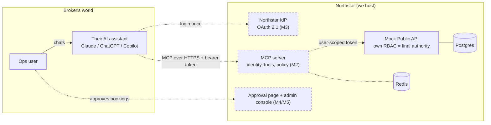
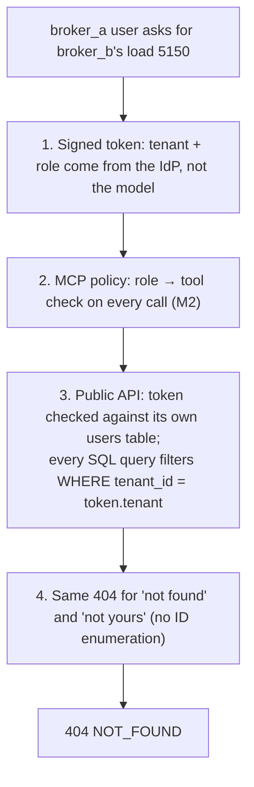
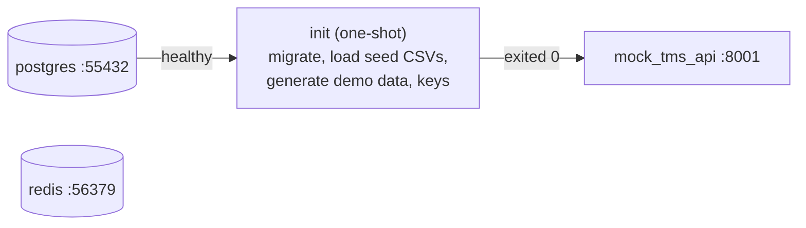

# Northstar TMS MCP MVP

Freight-broker ops teams already use their own AI assistants (Claude, ChatGPT, Copilot). This project builds a **Northstar MCP server** those assistants can connect to. It sits on top of the existing Northstar Public API, so an agent can never see or do more than its user's role allows. Financial actions such as booking a load need human approval.

**Status:** milestones M0 and M1 are done. That covers the Postgres schema, the curated real-world data, a deterministic synthetic data generator, and a mock Public API that enforces its own RBAC and tenant isolation. The MCP server (M2), OAuth (M3), approvals (M4) and later milestones are next. See the [roadmap](docs/superpowers/plans/2026-10-20-roadmap.md). More diagrams: [docs/architecture.md](docs/architecture.md).

## Architecture

Solid boxes exist today; dashed boxes are planned.



### How cross-broker access is prevented



Layers 1, 3 and 4 are implemented and tested today. Layer 3 alone stops a cross-tenant read even if layer 2 has a bug.

### What `docker compose up` starts



## Prerequisites

- Git
- Docker Desktop (Compose v2), **running**
- Only for running the tests: [uv](https://docs.astral.sh/uv/getting-started/installation/). uv installs Python 3.13 by itself if needed.

Nothing else: no local Python, Postgres or API keys needed to run the stack. Free host ports needed: 8001, 55432, 56379.

## Quickstart

```
git clone <this-repo-url> northstar-mcp
cd northstar-mcp
docker compose up --build -d
docker compose ps
```

This starts Postgres and Redis, then runs the one-shot `init` job. `init` applies migrations, loads the committed seed data, generates the demo data, and creates dev JWT keys. The mock Public API starts once `init` has finished. The first build takes a few minutes.

Expected `docker compose ps -a`: `postgres`, `redis` and `mock_tms_api` show `(healthy)`, and `init` shows `Exited (0)`. Check the API with `curl -s localhost:8001/health`, which should return `{"status":"ok"}`.

| Service | Port | Notes |
|---|---|---|
| `mock_tms_api` | 8001 | Mock Public API (`/health`, `/v1/...`) |
| `postgres` | 55432 | user/password/db: `northstar` |
| `redis` | 56379 | |
| `init` | - | One-shot: migrate, seed, create keys; exits 0 |

The API mounts the shared `keys` volume read-only. In this M1 shortcut that volume holds both PEMs; the API only reads the public one. M3 (OAuth: mock IdP) splits them so the private key is visible only to the IdP.

## Call the API

Mint a dev token in a throwaway `init` container (it owns the keys volume), then curl:

```
TOK=$(docker compose run --rm -T init python -c "from northstar_shared.tokens import mint_token; print(mint_token(open('/keys/jwt_private.pem','rb').read(), sub='a.ops', tenant='broker_a', role='ops_rep', aud='northstar-public-api', iss='http://mock-idp:9000'))")

# own load: 200, status in_transit, CHI -> DAL, no rate fields (ops_rep can't see financials)
curl -s -H "Authorization: Bearer $TOK" localhost:8001/v1/loads/4521

# latest tracking event: an ELD ping near Joliet, IL
curl -s -H "Authorization: Bearer $TOK" "localhost:8001/v1/loads/4521/events?limit=1"

# another broker's load: 404 {"error":"NOT_FOUND"} (identical to a load that doesn't exist)
curl -s -H "Authorization: Bearer $TOK" localhost:8001/v1/loads/5150

# no token: 401 {"error":"UNAUTHENTICATED"}
curl -s localhost:8001/v1/loads/4521
```

Browsable API docs (Swagger UI) are at <http://localhost:8001/docs>, and the raw spec is at `/openapi.json`. The docs page has no "Authorize" button yet, so use curl with the token for authenticated calls.

A minted token's `iss` must equal the API's `JWT_ISSUER` (default `http://mock-idp:9000`; overridable via `.env`), its `aud` must be `northstar-public-api`, and `sub`/`tenant`/`role` must match a seeded user, otherwise the API answers 401.

Windows Git Bash: if Git Bash rewrites paths such as `/keys/...` in the command, prefix it with `MSYS_NO_PATHCONV=1`. PowerShell users can run the same commands with `$TOK = docker compose run --rm -T init python -c "..."`.

## Demo users and fixtures

Users are `{a,b,c}.{ops,sales,pricing,manager,admin}` for tenants `broker_a/b/c`, with roles `ops_rep`, `carrier_sales`, `pricing`, `ops_manager`, `broker_admin`. Demo load/carrier fixtures are listed in the table in [docs/superpowers/plans/2026-10-20-roadmap.md](docs/superpowers/plans/2026-10-20-roadmap.md).

## Tests

```
docker compose up -d postgres
uv sync && uv run pytest -q
```

Tests create their own databases on the compose Postgres at host port 55432 (`TEST_DATABASE_URL`, see `.env.example`).

## Refresh demo data

`init` reseeds synthetic data (loads, events, quotes) automatically when the last seed is older than 12 hours. To force a fresh reseed now, relative to the current time:

```
docker compose run --rm -e FORCE_RESEED=1 init
```

Reference data (carriers, lanes, rates) is reloaded only when the seed version changes. Keep `DEMO_NOW=now`; the API uses the real clock.

## Reset

```
docker compose down -v
```

Removes the database and keys volumes; the next `up` re-seeds from scratch.

## Refresh source data

Optional; the curated seed is already committed. See [data/README.md](data/README.md) for the sources and manual downloads, then:

```
docker compose --profile refresh-data run --rm data
```

## What's next

See the [roadmap](docs/superpowers/plans/2026-10-20-roadmap.md): MCP server (M2), OAuth with a mock IdP (M3), approval flow for `book_load` (M4), and later milestones (admin console, evals, demo).
