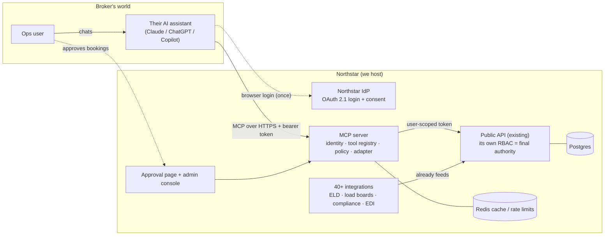
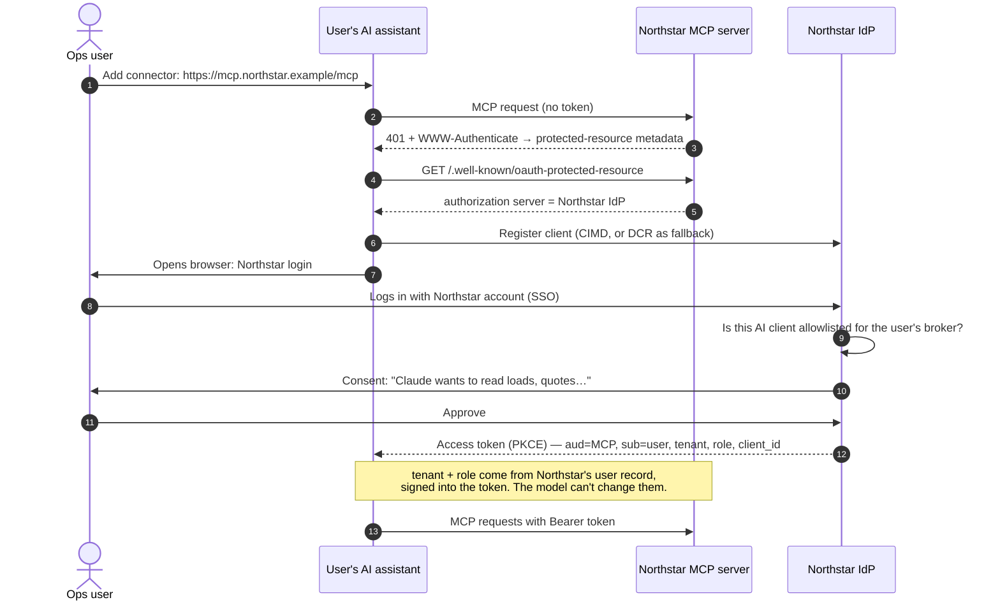
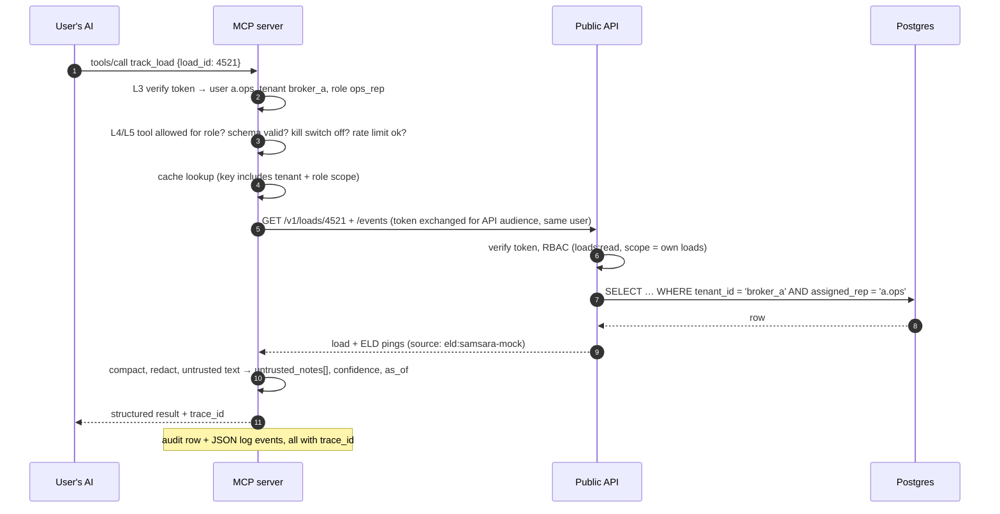
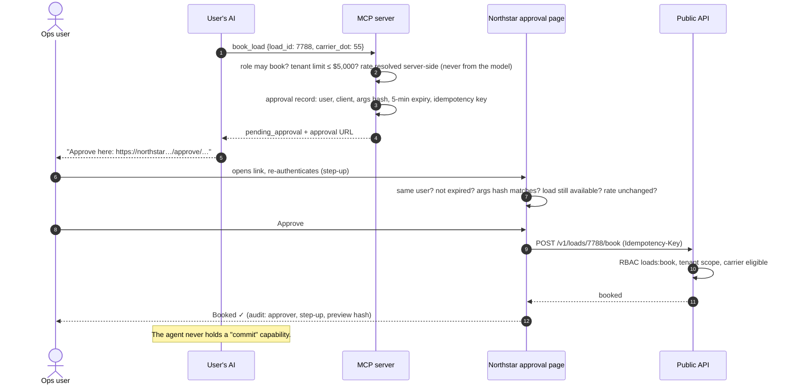
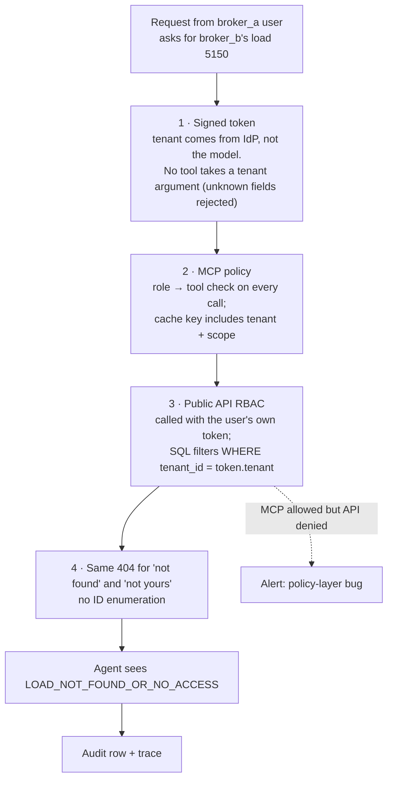
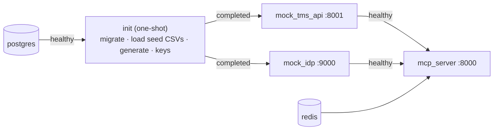
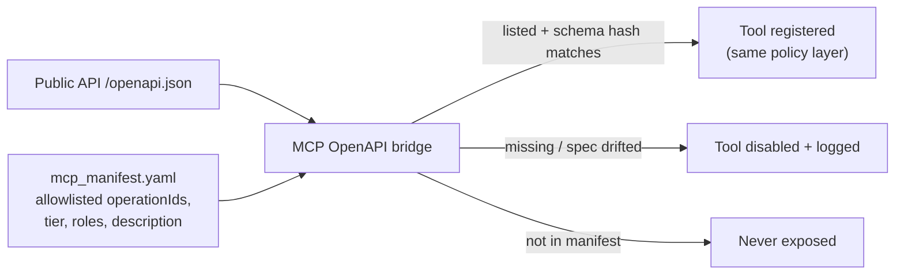

# Northstar MCP — Architecture at a glance

> These diagrams show the **target** architecture across all milestones. The README marks
> what exists today (M0+M1: data, init job, mock Public API with its own RBAC).

Broker ops teams already use their own AI assistant (Claude, ChatGPT, Copilot, …).
Northstar ships an **MCP server** that those assistants connect to. The server sits on top of
the existing Public API. Every permission check, approval and audit record lives on the
Northstar side, so every assistant behaves the same way.

## 1. System context

The assistant never talks to the API or the integrations directly. It only sees MCP tools.

## 2. Connecting an assistant (one time per user)

## 3. A read question ("Where's load 4521?")

## 4. A booking ("Book load 7788 with carrier 55") — tier 2

## 5. How cross-broker access is prevented (defence in depth)

Even if layer 2 had a bug, layer 3 still refuses, because the API trusts only the signed
token and never anything in the MCP request body. The demo shows this on purpose.

## 6. Deployment (local, one command)

`docker compose up --build`. Reset with `docker compose down -v`. Optional profiles:
`tracing` (Jaeger), `refresh-data` (re-download public data).

## 7. Generated tools from the OpenAPI spec

